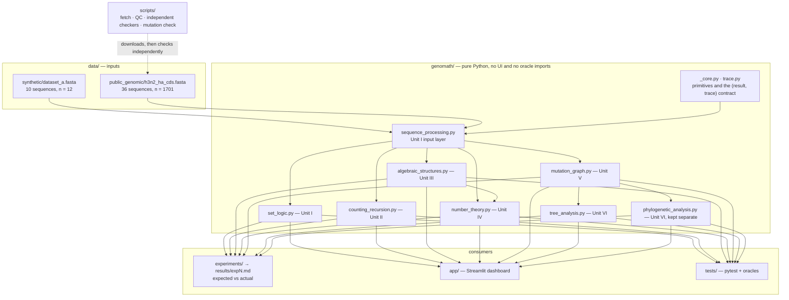
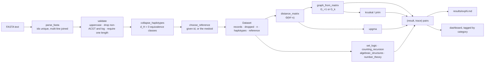

# Deliverable C — System design

## Architecture



**The one-way rule.** `genomath` imports nothing from `app`, `experiments`, `tests` or any third-party library.
`app/presentation.py` imports only `math`. Both rules are enforced by tests that parse the import statements
(`test_skeleton.py`, `test_app.py`), not by convention.

## Module descriptions

| Module | Responsibility | Key entry points |
|---|---|---|
| `genomath/trace.py` | the `(result, trace)` contract: steps tagged `observation`, `calculation`, `algorithm`, `interpretation`, `limitation`; per-element steps capped at 10 with the remainder kept in `data` | `Trace.add`, `Trace.add_steps` |
| `genomath/_core.py` | untraced primitives used inside O(N²) loops, plus `SequenceError`, which carries the trace built so far | `mismatch_positions`, `reverse_complement` |
| `genomath/sequence_processing.py` | parse, validate, collapse to haplotypes, choose the reference, assemble a `Dataset` | `load_dataset`, `build_dataset` |
| `genomath/set_logic.py` | mutation sets, set operations, the distance identity, predicates, relation properties, Warshall closure | `mutation_set`, `relation_properties` |
| `genomath/counting_recursion.py` | counts, the recurrence, guarded generation, inclusion–exclusion, pigeonhole, k! orderings | `mutation_count`, `generate_mutants` |
| `genomath/algebraic_structures.py` | string transformations, Cayley tables, axioms, orbits, Burnside, the substitution monoid, the base-level group | `cayley_table`, `burnside`, `substitution_census` |
| `genomath/number_theory.py` | encode/decode, complement and RC on codes, canonical k-mers, buckets, Euclid, CRT, orders | `encode`, `bucket_report`, `crt` |
| `genomath/mutation_graph.py` | graph construction, matrices, traversals, components, connectivity, Dijkstra, threshold sweep | `build_graph`, `dijkstra`, `threshold_sweep` |
| `genomath/tree_analysis.py` | Prim, Kruskal, validation, MST counting via Kirchhoff, rooted trees, traversals | `kruskal`, `prim`, `root_tree` |
| `genomath/phylogenetic_analysis.py` | UPGMA with exact fractions, cophenetic distances, the ultrametric test, split comparison | `upgma`, `fit_to_input` |
| `app/presentation.py` | pure display shaping: trace flattening, table shaping, graph and dendrogram layout | `trace_rows`, `spring_layout` |
| `app/ui.py`, `app/sections.py`, `app/main.py` | rendering, the seven sections, entry point and sidebar | `main` |

## Data flow



Every arrow out of a `genomath` function carries a trace alongside the value, which is what makes the final two boxes
possible: nothing is displayed or written to a results file without the steps that produced it.

## Preprocessing rules

Applied in order by `build_dataset`; every decision is logged into the trace and shown in the dashboard.

1. **Uppercase** the sequence.
2. **Drop** any record containing a character outside {A, C, G, T}, recording the id and the offending characters.
   Ambiguity codes are *not* resolved or imputed, because that would mean inventing a base. On Dataset B this drops
   MH246583.1 (one R) and MK181701.1 (one R, one Y).
3. **Require one common length**, otherwise raise `SequenceError`. Alignment is out of scope, so unequal lengths cannot
   be compared position by position.
4. **Collapse identical sequences** into haplotypes, keeping the member list. Dataset B: 34 records → 30 haplotypes.
5. **Choose the reference**: the id given by the caller, or else the **medoid** — the haplotype minimising the total
   distance to all others, ties broken by the smallest id (decision D4). On Dataset B this is CY249987.1.

The reference changes every mutation set M(R,S) but no pairwise distance d_H(S,T); the dashboard says so where the
reference is chosen.

## Dataset rationale

**Dataset A (synthetic, 10 × 12 nt).** Designed so that every structural case has a hand-checkable answer: an identical
pair (syn03 = syn10), an RC-palindrome (syn01), a 4-step chain, a square of unit edges forcing MST ties (8 distinct
MSTs), an RC pair (syn03/syn08), a shared-position-but-different-allele pair (syn03/syn07), and an outlier (syn09)
that keeps the graph disconnected until k = 6. Small enough that a reader can check any claim with pen and paper.

**Dataset B (GenBank, 36 × 1701 nt).** Influenza A(H3N2) hemagglutinin coding sequences, human host, 2017–18 northern
season. Chosen because the sequences are homologous, closely related and **naturally equal-length**, so positional
comparison is meaningful without alignment — the quality-control check is that the maximum pairwise distance is
57/1701 = 3.4%, whereas a misaligned pair would sit near 75%. The set is small enough for O(N³) algorithms on a laptop
and contains real structure to find (8 pairs at distance 1). GenBank is used rather than GISAID so the data can be
redistributed; NCBI states it places no restrictions on use or distribution.

**Selection procedure.** `scripts/fetch_public_data.py select` searches GenBank, pages through all 11,887 hits, sorts
them by accession, takes 600 evenly spaced candidates, and keeps those with serotype H3N2, a human host, a complete
HA CDS and a collection month inside the season (171 remain). It keeps the modal CDS length (1701, all of them) and
selects 36 evenly spaced. `refetch` re-downloads exactly the recorded accessions and is the reproducible path.
Known biases: 31 of 36 are United States deposits, and records without a collection month are excluded.

## Algorithm pseudocode

**Haplotype collapse and reference choice**
```
collapse(records):
    groups ← ordered map from sequence to list of ids
    for r in records: groups[r.seq].append(r.id)
    return [Haplotype(ids[0], seq, ids) for seq, ids in groups]      # first member names the class

medoid(haplotypes):
    total[h] ← Σ_{o ∈ haplotypes} d_H(h.seq, o.seq)
    return argmin over h of (total[h], h.id)                          # ties by smallest id
```

**Threshold graph and sweep** — the distance matrix is computed once and reused, so a sweep is O(t·N²) after Θ(N²·n).
```
graph_from_matrix(ids, d, k):
    E ← { (ids[i], ids[j], d[i][j]) : i < j, 1 ≤ d[i][j] ≤ k }
    return Graph(ids, E)
```

**Dijkstra, array version** (no library heap; weights d_H ≥ 1 are non-negative)
```
dijkstra(G, source):
    dist[v] ← ∞ for all v; dist[source] ← 0; settled ← ∅
    repeat until no unsettled vertex has a finite distance:
        u ← unsettled vertex minimising (dist[u], index(u))           # ties by vertex order, for reproducibility
        settled ← settled ∪ {u}
        for (v, w) in neighbours(u) with v ∉ settled:
            if dist[u] + w < dist[v]: dist[v] ← dist[u] + w; prev[v] ← u
    return dist, prev
```

**Kruskal** (hand-written merge sort and union–find with path compression and union by rank)
```
kruskal(G):
    order ← merge_sort(edges(G), key = (weight, endpoint indices))
    uf ← UnionFind(vertices(G)); T ← []
    for (u, v, w) in order:
        if |T| = |V| − 1: break
        if uf.union(u, v): T.append((u, v, w))                        # accept iff it joins two components
        else: record a rejection: it would close a cycle
    return T
```

**Counting minimum spanning trees** (weight-level contraction + Kirchhoff)
```
count_msts(G):
    total ← 1; uf ← UnionFind(vertices(G))
    for each weight level w in increasing order:
        crossing ← edges of weight w whose endpoints are in different components of uf
        for each connected group of super-vertices joined by `crossing`:
            total ← total × kirchhoff(group, its crossing edges)      # cofactor of the Laplacian, exact rationals
        merge all edges of weight w into uf
    return total
```

**UPGMA** (exact `Fraction` arithmetic; tie-break D8)
```
upgma(ids, d):
    clusters ← one per id; heights ← 0
    while more than one cluster:
        best ← minimum pairwise distance
        tied ← all pairs attaining it
        (a, b) ← the tied pair whose sorted member tuples come first lexicographically
        new ← merge(a, b); height[new] ← best / 2
        for each remaining cluster x:                                  # size-weighted = mean over member pairs
            d[new, x] ← (|a|·d[a,x] + |b|·d[b,x]) / (|a| + |b|)
    return tree, heights, merge table with the tie count per step
```

## Guards and failure modes

| Situation | Behaviour |
|---|---|
| non-ACGT character | record dropped, id and characters logged, shown in the dashboard |
| unequal lengths | `SequenceError` carrying the partial trace; the dashboard renders it instead of crashing |
| empty input, or everything dropped | `SequenceError` with the reason |
| generation above 10⁵ strings | `GenerationLimitError` with the predicted count, before any work is done |
| exhaustive orbit enumeration above n = 10 | refused with the size that would be required |
| κ or λ above 16 vertices | refused; the dashboard explains why rather than hanging |
| matrices on a 30-vertex graph | omitted from the dashboard with a note, still available from the modules |
| traces with thousands of per-element steps | capped at 10 shown, remainder kept in the step's `data` |
